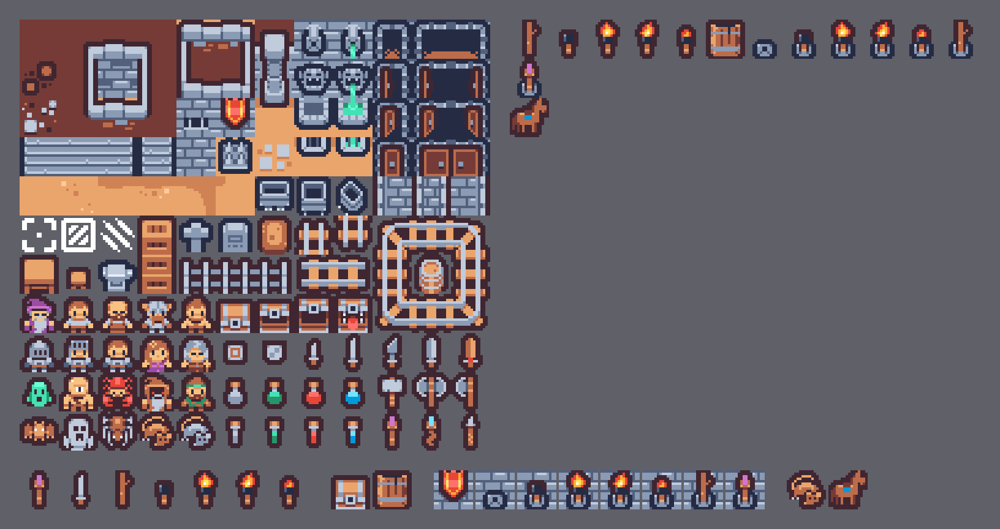

<!--
Copyright (c) 2026 Jurjen Stellingwerff
SPDX-License-Identifier: LGPL-3.0-or-later
-->

# The game's own sheet

The Kenney sheets have no torch that burns out, no tar and no horse.  `tile-world.png` is a
sheet of our own that sits BESIDE them.  It is drawn in the Tiny Dungeon style, so a tile of
ours next to one of Kenney's reads as one set.  It also leaves room for what comes later, such
as more monsters; the horse is its first addition beyond light.  The rules its tiles serve
(torches, tar, sockets, light) are in [DESIGN.md § Torches and light](DESIGN.md#torches-and-light).

## The sheet

- **File.**  `assets/sheets/tile-world.png`, CC0 like Kenney's (`tile-world-License.txt`
  beside it).  It is named `world` in `theme.json` once the game draws from it.
- **Grid.**  16 × 16 tiles with no spacing, 12 columns (192 px), the same as
  `tiny-dungeon.png`.  The sheet grows DOWN by whole rows.
- **Indices never move.**  `materials.loft` numbers a tile `1 + slot * 256 + tile`, and levels
  and stamps store that number.  So a tile, once added, keeps its index.  A retired tile stays
  in place (blank), and `world` is listed LAST in `theme.json`'s `sheets` so no existing number
  shifts.  The cap is 256 tiles a sheet (21 rows); a second sheet of ours follows when that fills.
- **Rows by family**, so a new addition has a home without a reshuffle:

| rows | family | now |
|---|---|---|
| 0–1 | fire and light | tiles 0–12 below |
| 2 | travel | 24: the horse |
| 3– | later additions (monsters, …) | |

### The tiles

| index | tile | used for |
|---|---|---|
| 0 | stick | a plain stick; also what a torch is once it has burnt out |
| 1 | torch | tarred, not burning |
| 2 | burning torch, frame A | held or lying; the flame leans left |
| 3 | burning torch, frame B | the same torch, the flame leaning right: A and B differ only in the flame |
| 4 | burning torch, low | its last minute: a small red flame |
| 5 | tar barrel | turns a stick into a torch |
| 6 | wall socket | an empty iron ring on a wall |
| 7 | socket with a torch | not burning |
| 8, 9 | socket with a burning torch, frames A and B | |
| 10 | socket with a low torch | its last minute |
| 11 | socket with a stick | a torch that burnt out in the socket |
| 12 | socket with the staff | Kenney's staff (dungeon:129) as it is |
| 24 | horse | side view, facing right, saddled |

## The style, measured from `tiny-dungeon.png`

- **Palette.**  Only the 27 colours `tiny-dungeon.png` uses, one letter each in
  `assets/art/world/palette.txt`; `tools/sheet.loft` refuses any other.
- **Outline.**  `#3f2631` (`o`), 2 px thick on the outside with rounded corners: every empty
  pixel within dx² + dy² ≤ 5 of the figure (measured on the staff, dungeon:129).  Where two
  things overlap, the line between them is 1 px.  **Iron on a wall is outlined in navy**
  (`n`, `#262b44`), as Kenney's wall fittings are (dungeon:7, 19); wood and cloth keep `o`.
- **Ramps.**  Wood: `b` `m` `t` (`#763b36` `#bd6c4a` `#eaa56c`).  Iron: `n` `s` `g` `l`.
  Flame: `r` rim, `y` body, `Y` heart, one `w` hot pixel.  Tar: `n` with an `s` or `g` gloss.
- **Light comes from the top left**: a highlight edge, a shadow edge, flat fills between.  No
  dithering, no anti-aliasing.
- **Items stand upright and centred**, like the sword (104) and the staff (129).  The flame
  never touches the tile's sides.
- **Sockets are overlays**: transparent except the ring and what it holds, so a socket shows on
  any wall's bricks.

## How the sheet is made

Kenney's tiles are drawn larger first and reduced to their size, so that is how these are made.

1. **Drawn large.**  A tile starts as a scene in `assets/art/world/large/NN-name.draw`, 16 times
   the tile (256 × 256), in the scene language of crawler's drawing set
   ([SPRITES.md](../crawler/SPRITES.md)).  Render one with crawler's `tools/draw.py`
   (`SKETCH_OUT=<dir> python3 ../crawler/tools/draw.py --once <scene>`), or with the loft
   `drawing` library, which renders the same scenes byte for byte.  No outer ink is drawn: the
   reduction adds the outline.
2. **Reduced.**  `loft --lib libs tools/reduce.loft <canvas.png> <tile.txt> [outline letter]`
   turns each 16 × 16 block into one pixel.  A block less than half covered becomes
   transparent; otherwise it takes the palette colour most of its pixels are nearest to.  Then
   the outline goes on.
3. **The hand pass.**  The tile, `assets/art/world/NN-name.txt`, is 16 lines of 16 letters (`.`
   transparent).  The hand pass happens there: a pixel is one character.  Done so far:
   - the flame tips (2, 3);
   - the base of flame B, made the same width as A's so the head stays still while the flame
     flickers (3);
   - the glint on the tar (1);
   - the horse's ear, eye and legs (24).

   Reducing a tile again starts it over and drops its hand pass.
4. **Composed.**  The socket tiles (6–12) are not drawn one by one; `composed.txt` puts each
   together from three parts:
   - the ring's back half (`layers/socket-back.txt`);
   - what the socket holds (a tile of the sheet, or Kenney's staff in `layers/kenney-staff.txt`),
     cut where the ring hides it;
   - the ring's front band (`layers/socket-front.txt`).

   The ring is Kenney's own size (dungeon:7's spout ring, 6 px with a 2 px hole), too small to
   survive a reduction, so its layers are drawn at 16 px.  The bracket and the torch are
   therefore the same pixels in every socket tile.
5. **Built.**  `loft --lib libs tools/sheet.loft` writes `tile-world.png`.  With `check` it
   instead exits 1 when the committed sheet differs from the sources (`check`, not `--check`:
   a `--` flag after the script is loft's own).

## Presenting it

`loft --lib libs tools/present.loft` writes `assets/sheets/tile-world-presentation.png` (above),
at 4×:

1. the two sheets side by side;
2. each new tile beside the Kenney tile it must match: the stick and the torches by the staff
   and the sword, the barrel by the chest, the sockets on the wall's bricks beside the banner,
   and the horse by the rat.

A third part waits for the rules: `the_cellar` dark, lit only by socket torches, as a `TW_SHOT`
picture.

## Animation

The game draws one picture per thing today.  The burning tiles come in two frames (A, B)
alternating every 250 ms of the level clock, which needs `theme.json` to accept
`"frames": ["world:2", "world:3"]` for a thing.  Until it does, frame A alone is drawn.
